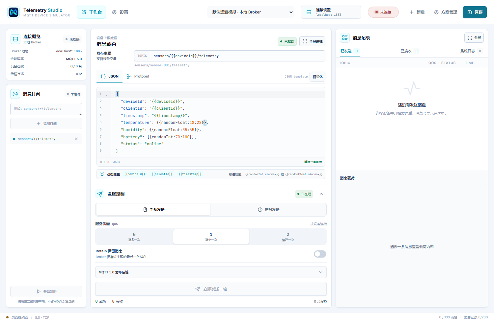
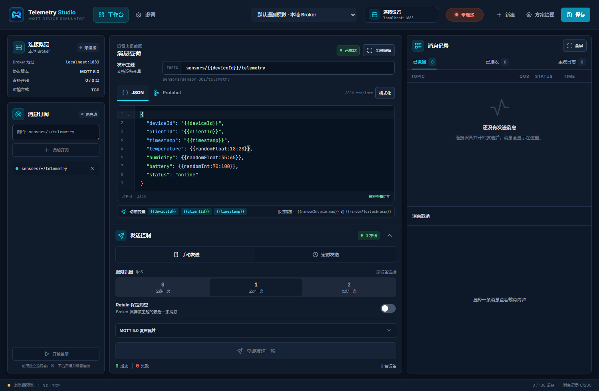
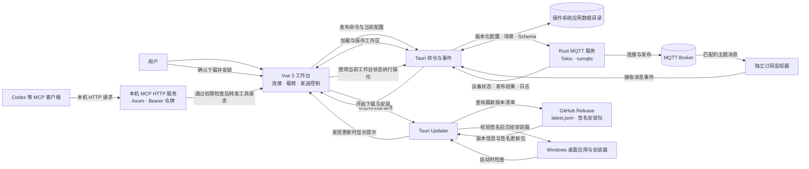

# MQTT 设备模拟器

面向 IoT 开发与联调的 Windows 桌面工作台。用户可以配置 MQTT Broker 和虚拟设备批次，发布 JSON 或 Protobuf 遥测数据，并在同一界面检查发送结果、订阅消息与运行日志。

桌面端由 Tauri 2、Vue 3、TypeScript 和 Rust 组成。浏览器预览用于查看和调整前端界面；MQTT 连接、设备仿真、本机 MCP 服务和自动更新都需要在 Tauri 桌面应用中运行。

## 工作台截图

截图来自 `1500 × 980` 浏览器预览，展示默认遥测模板和未连接状态。浏览器预览不连接 Broker，因此消息记录为空。

| 浅色主题 | 深色主题 |
| --- | --- |
|  |  |

## 能力概览

| 区域 | 能力 |
| --- | --- |
| Broker 与设备 | MQTT 3.1.1/5.0、TCP/TLS、用户名密码、可选 CA、单批最多 100 台独立设备、失败重试和断线重连 |
| 消息载荷 | JSON 模板变量；自包含 proto3 Schema 编辑、字段表单、编码、解码和 Hex 查看 |
| 发布 | 手动或定时发送、QoS 0/1/2、Retain、每台设备发送次数及 MQTT 5 发布属性 |
| 订阅监视 | 使用独立 MQTT 客户端监听多个主题过滤器，不占用模拟设备连接 |
| 工作台 | 左侧连接概览和订阅、中间载荷与发送控制、右侧消息记录与载荷详情 |
| 偏好与集成 | 深色、浅色和跟随系统主题；可选本机 MCP 服务，按类别授权 AI 客户端操作 |
| 更新与品牌 | A 版应用图标；桌面启动检查 GitHub 最新签名版本，用户确认后安装并重启 |

## 数据流程



发布链路的消息说明：虚拟设备各自建立 MQTT 会话；订阅监视器使用另外的客户端。MCP 请求经过 Bearer 令牌和工具权限检查，并通过当前工作台操作；浏览器预览不会启动这些 Rust 服务。

## 运行环境

- Windows 10/11 x64。
- Node.js 20.19 或更高版本、Corepack 和 pnpm 9.15.5（GitHub Release 工作流使用此版本）。
- Rust stable、MSVC 工具链和 Microsoft C++ Build Tools。
- WebView2 Runtime（Tauri 桌面应用使用）。

## 安装与开发

在项目根目录安装依赖：

```powershell
corepack enable
corepack prepare pnpm@9.15.5 --activate
pnpm install --frozen-lockfile
```

启动前端浏览器预览：

```powershell
pnpm dev
```

预览地址为 `http://127.0.0.1:1430/`。在桌面应用中开发可运行：

```powershell
pnpm tauri dev
```

**已知待处理项：** Vite 开发命令使用端口 `1430`，而 `src-tauri/tauri.conf.json` 当前的 `devUrl` 是 `1420`。这两个端口需要在 Windows 桌面验收前统一；浏览器预览不受影响。该项已列入 [plan.md](plan.md) 的 P0 计划。

浏览器预览只运行前端，不会连接 MQTT Broker、运行 MCP 或执行桌面更新检查。

## 构建 Windows 安装包

```powershell
pnpm tauri build
```

安装包目标为 NSIS，构建结果位于：

```text
src-tauri/target/release/bundle/nsis/
```

## 基本使用

1. 在顶部选择已有连接方案，或使用“新建”创建 Broker 配置与模拟场景。
2. 在“连接设置”中填写 Broker 地址和端口；如需认证，填写用户名、密码；如使用 TLS，可指定 CA 证书。
3. 设置 MQTT 版本和设备批次。每台虚拟设备使用唯一 Client ID；连接失败时可单独或批量重试。
4. 在“消息载荷”中选择 JSON 或 Protobuf。JSON 使用主题模板和载荷模板；Protobuf 选择自包含 Schema、消息类型与字段值。
5. 在“发送控制”中设置 QoS、Retain、手动/定时模式、发送间隔和每台设备的发送次数。次数留空时持续发送，直到停止。
6. 在“消息订阅”添加一个或多个主题过滤器并启动独立监听。右侧“消息记录”可以查看已发送、已接收消息和系统日志；选择消息可检查载荷。
7. 使用顶部“设置”切换深色、浅色或系统主题；需要时配置本机 MCP 服务和权限。

保存的连接配置、模拟场景和 Schema 可在重启后继续使用。密码只保存在当前进程内存中；消息历史和日志不会持久化。

## JSON 模板

模板支持以下占位符：

| 占位符 | 含义 |
| --- | --- |
| `{{deviceId}}` | 当前虚拟设备 ID |
| `{{clientId}}` | 当前 MQTT Client ID |
| `{{timestamp}}` | 当前 UTC ISO 8601 时间 |
| `{{randomInt:min:max}}` | 包含上下界的随机整数 |
| `{{randomFloat:min:max}}` | 指定范围内的随机小数 |

随机数占位符生成 JSON 数值，变量外不要再套引号。发布前会检查变量、范围和 JSON 结构；格式错误时不会发送消息。

```json
{
  "deviceId": "{{deviceId}}",
  "clientId": "{{clientId}}",
  "timestamp": "{{timestamp}}",
  "temperature": {{randomFloat:18:30}},
  "battery": {{randomInt:50:100}},
  "status": "online"
}
```

## Protobuf

Schema 使用自包含的 proto3 文本定义。当前支持标量、枚举、嵌套消息、repeated 和 bytes 字段；bytes 可输入 Hex 或 `base64:<内容>`。暂不支持引用外部 `.proto` 文件或多文件依赖。

“自动填充”只补空字段，不覆盖已有值。填充值优先使用 Schema 默认值；否则按类型生成稳定样例。枚举使用首个值，repeated 字段生成一项，嵌套消息递归填充。发布的 MQTT 载荷是编码后的二进制；接收 Protobuf 消息可用匹配的 Schema 解码，或查看原始 Hex。

## MQTT 与消息监视

- MQTT 3.1.1 和 5.0 均支持 QoS 0/1/2 与 Retain。
- MQTT 5.0 支持 Session Expiry、Message Expiry、Response Topic、Correlation Data、Content Type 和用户属性。切换到 MQTT 3.1.1 后会隐藏 MQTT 5 专属设置。
- 每批最多 100 台设备，每台设备单独连接；同一批共用 Broker 地址和认证信息。
- 意外断线会按退避策略重连，间隔最多 30 秒。离线时不排队积压消息。
- QoS 0 没有 Broker 确认，界面标记为“未确认”；QoS 1/2 根据 Broker 确认统计结果。
- 订阅监视器为独立客户端。每个活动面板最多保留 200 条记录，应用退出后清空。

## MCP 与 Codex

MCP 只在 Tauri 桌面应用中提供，默认关闭；服务仅绑定 `127.0.0.1:39541/mcp`，请求需要 Bearer 令牌。每次启动应用时服务都保持关闭，需要用户在设置页主动启用。浏览器预览不会启动 MCP。

设置页提供端点、令牌、Codex TOML 示例和 PowerShell 环境变量命令。配置格式如下：

```toml
[mcp_servers.telemetry-studio]
url = "http://127.0.0.1:39541/mcp"
bearer_token_env_var = "TELEMETRY_STUDIO_MCP_TOKEN"
```

在启动 Codex 的 PowerShell 会话中设置设置页提供的令牌：

```powershell
$env:TELEMETRY_STUDIO_MCP_TOKEN = "<设置页中的令牌>"
```

MCP 工具按四类权限控制：读取状态（默认开启）、连接控制、仿真控制和发布消息（后三类默认关闭）。工具操作当前工作台选择的配置、载荷和发送选项，不维护独立副本。

## 自动更新与 GitHub 发布

桌面应用启动后会检查 GitHub 最新 Release。若发现更高版本，会显示说明和版本号；用户可稍后处理，或确认下载并安装。安装包通过 updater 公钥校验，Windows 安装完成后自动重启。断网、暂时无法读取 Release 或检查超时不会阻止应用启动。

发布工作流由 `v*` Git 标签触发。发布前需将以下文件中的版本号设为同一个值，然后推送对应标签：

- `package.json`
- `src-tauri/tauri.conf.json`
- `src-tauri/Cargo.toml`

例如版本为 `0.2.0` 时推送标签 `v0.2.0`。GitHub Actions 会构建 Windows 安装包并上传 `latest.json` 和签名文件。仓库必须配置 `TAURI_SIGNING_PRIVATE_KEY`，如私钥有密码还需配置 `TAURI_SIGNING_PRIVATE_KEY_PASSWORD`；私钥需与 `src-tauri/tauri.conf.json` 的 updater 公钥配对。完整步骤见 [docs/releasing-updates.md](docs/releasing-updates.md)。

截至 2026-10-26，配置的 `latest.json` 地址尚未返回发布清单。首个带签名的 GitHub Release 发布后，客户端才会检测到可用更新。

## 数据与安全边界

- Broker 配置、模拟场景和 Schema 以带版本的 JSON 存放在操作系统应用数据目录。
- Broker 密码仅保留在当前应用进程内存中；不要将密码写入模板、Schema、日志或 MCP 配置示例。
- 发送记录、接收记录和系统日志仅保存在内存中，每类最多 200 条。
- MCP 令牌用于本机服务鉴权，可在设置页轮换。不要在共享截图或公共日志中展示令牌。
- TLS 默认使用系统信任；可以指定 CA 文件。不支持双向 TLS 客户端证书。
- 首版面向开发联调，不适合作为高吞吐压力测试工具。
- 浏览器预览不连接 Broker、不启动 MCP，也不检查桌面更新。

## 项目结构

| 路径 | 作用 |
| --- | --- |
| `src/App.vue` | 顶部导航、工作台组合、更新检查与提示 |
| `src/components/` | Broker、连接概览、订阅、载荷、发布、消息记录、设置和方案管理界面 |
| `src/composables/useSimulator.ts` | 工作区状态、Tauri 命令和 MQTT 生命周期 |
| `src/composables/useThemePreference.ts` | 深色、浅色和系统主题偏好 |
| `src/lib/payload.ts` | JSON 模板、Protobuf Schema、编码解码和 bytes 处理 |
| `src-tauri/src/mqtt.rs` | Rust MQTT 设备会话、监视器、发送、重连和事件 |
| `src-tauri/src/mcp.rs` | 本机 MCP HTTP 服务、Bearer 鉴权和工具权限 |
| `src-tauri/src/storage.rs` | 本地工作区加载与保存 |
| `.github/workflows/release.yml` | 版本标签校验、签名构建和 GitHub Release 上传 |
| `spec.md` | 产品范围、用户故事、约束与验收标准 |
| `plan.md` | 已完成工作、验收阶段和后续路线图 |

## 本地检查与排障

```powershell
pnpm run build
cargo check --manifest-path src-tauri/Cargo.toml
cargo fmt --manifest-path src-tauri/Cargo.toml -- --check
```

常见问题：

- **浏览器预览中无法连接 Broker 或 MCP：** 这是预期行为，请使用 Tauri 桌面应用。
- **Broker 连接失败：** 检查 Broker 地址、端口、防火墙、MQTT 版本、认证信息及 CA 文件是否匹配。
- **Protobuf 解析失败：** 确认 Schema 为自包含 proto3 定义，消息类型名称和字段类型正确。
- **没有检测到更新：** 检查应用版本、Git 标签、Release 的 `latest.json` 和签名配置；当前仓库地址在首个签名 Release 发布前不会有可安装更新。
- **桌面开发加载失败：** 确认 `devUrl` 与 Vite 实际监听端口一致；目前已记录此项待修复。

更多产品约束与验收标准见 [spec.md](spec.md)，下一步实施顺序见 [plan.md](plan.md)。
